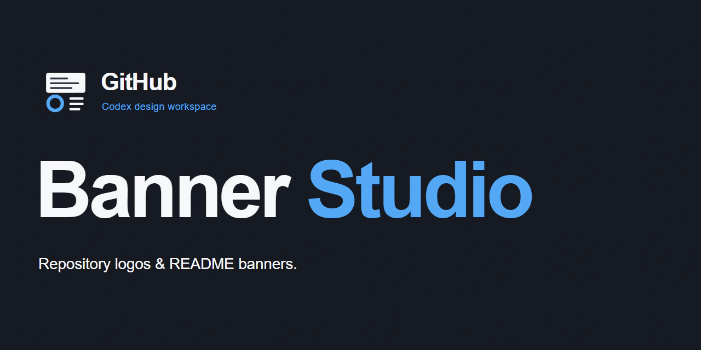

# GitHub Banner Studio



A Codex workspace for creating GitHub README banners and repository logos. Three Skills guide banner, logo, and brand workflows; local tools render, export, and validate the assets.

## Set up

Install Git and Bun 1.4.3, then run:

```bash
git clone https://github.com/sky9154/Github-Banner-Studio.git
cd Github-Banner-Studio
bun install --frozen-lockfile
bun run setup:browser
```

Open the cloned repository in Codex.

## Use the Skills

Open this repository in Codex to use the Skills in `.agents/skills/`:

- `$repository-banner` creates or updates a README banner.
- `$repository-logo` creates, refines, or exports a repository logo.
- `$repository-brand` guides a complete logo and banner workflow, with two design directions and approval at each stage.

Read each Skill's `SKILL.md` and references for workflow details.

## Install the Plugin

Add the repository as a marketplace, then install GitHub Banner Studio:

```bash
codex plugin marketplace add sky9154/Github-Banner-Studio
codex plugin add github-banner-studio@github-banner-studio
```

Run `codex plugin list` to confirm the installation.

## Run the tools

Run commands from the Studio root and save outputs under `banners/` or `logos/`.

| Command | Purpose |
| --- | --- |
| `bun run render 'banners/<owner>/<repository>'` | Render a banner preview. |
| `bun run export 'banners/<owner>/<repository>'` | Export the banner as WebP. |
| `bun run validate 'banners/<owner>/<repository>'` | Validate banner files and hashes. |
| `bun run logo:render 'logos/<owner>/<repository>'` | Render a logo preview. |
| `bun run logo:export 'logos/<owner>/<repository>'` | Export PNG, WebP, and small-size previews. |
| `bun run logo:validate 'logos/<owner>/<repository>'` | Validate logo files and exports. |
| `bun run brand:validate 'logos/<owner>/<repository>'` | Check consistency between the approved logo and banner. |

Add `--help` to see command options.

## Output formats

- **Banner:** 1280 × 640 WebP with editable HTML, CSS, and SVG sources.
- **Logo:** square SVG source with PNG and WebP exports.

See [architecture](docs/architecture.md) and [workflow](docs/workflow.md) for more information.

## License

Released under the [MIT License](LICENSE). Copyright © 2026 oF.
